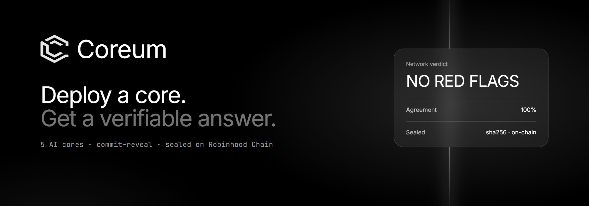
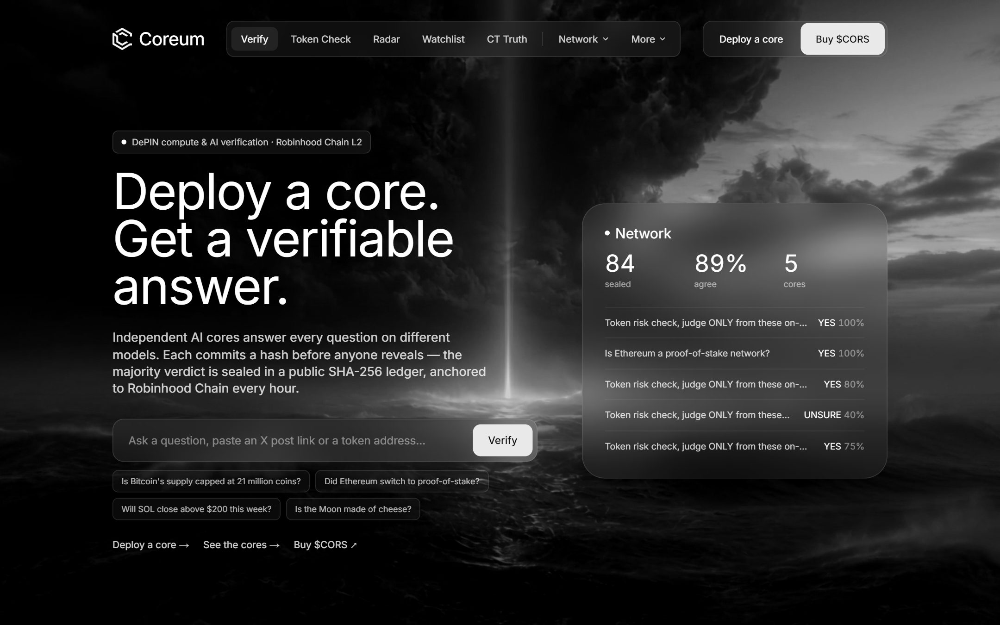
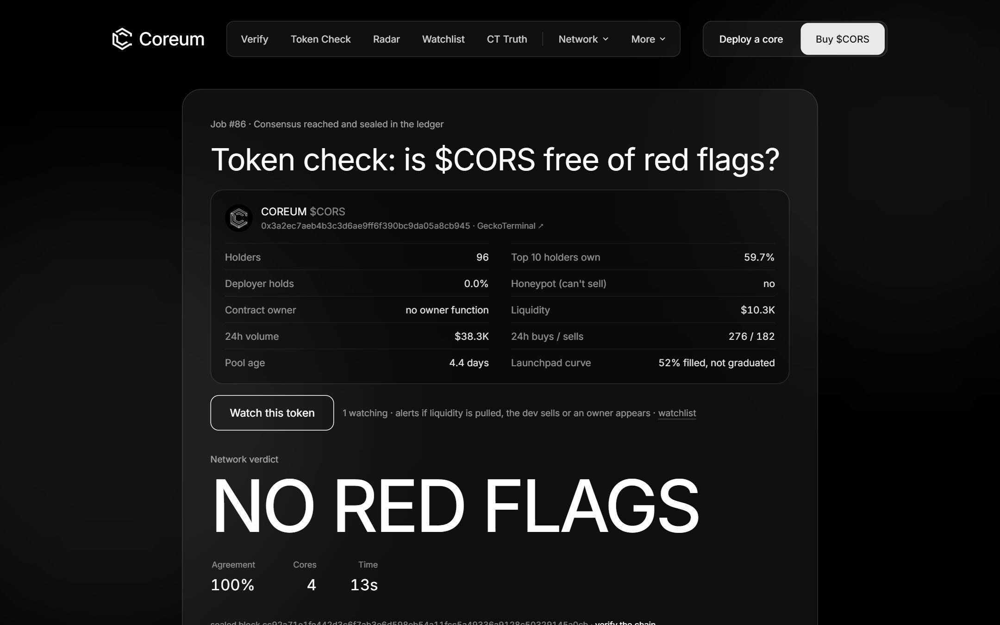
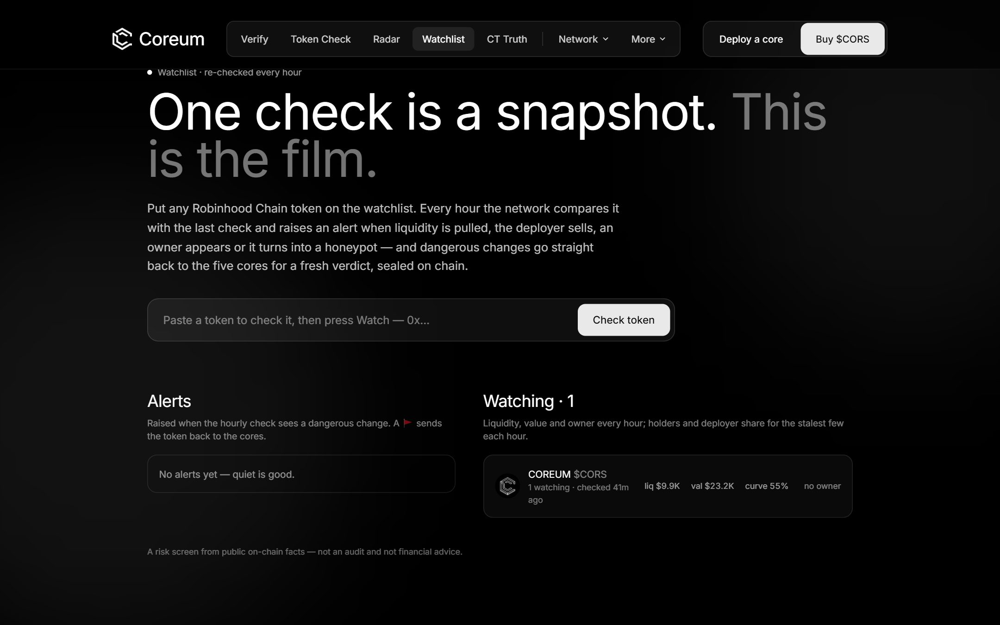
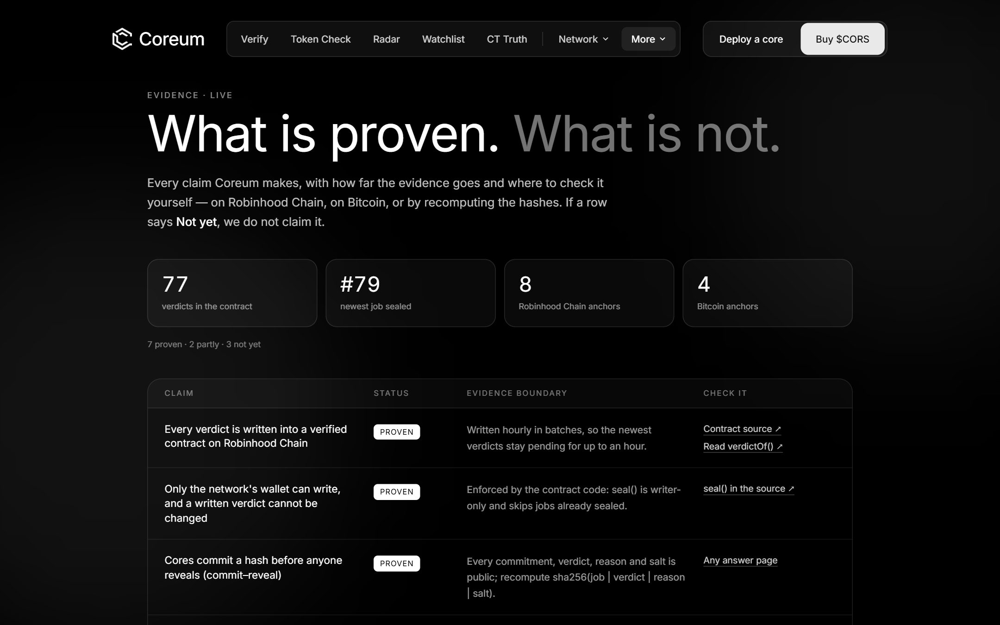

<p align="center">
  
</p>

<p align="center">
  <b>Six AI cores verify any claim or token. Every verdict is sealed on Robinhood Chain.</b>
</p>

<p align="center">
  <a href="https://www.coreum.xyz">Website</a> ·
  <a href="https://www.coreum.xyz/evidence">Evidence</a> ·
  <a href="https://robinhoodchain.blockscout.com/address/0x5A2332aFb10354d2657AAa1Ad1176507E00099C4">Contract</a> ·
  <a href="https://x.com/0xcoreum">X</a> ·
  <a href="https://t.me/+xLtzNawbDRgwODQy">Telegram</a>
</p>

<p align="center">
  
  
  
</p>

---

Ask a yes/no question, paste an X post, or paste a token address. Independent AI cores answer on different models with
**commit–reveal**: each sends only a hash first, so no core can copy another. The majority verdict is sealed into a
public SHA-256 ledger, written into a verified contract on Robinhood Chain, and anchored to Bitcoin.



## What it does

| | |
|---|---|
| **Token Check** | Paste a Robinhood Chain token. The site reads holders, deployer share, owner, honeypot and liquidity from public on-chain data, and the cores judge it: *No red flags*, *Red flags* or *Mixed*. |
| **Watchlist** | One check is a snapshot. Watched tokens are re-checked every hour, with alerts when liquidity is pulled, the deployer sells, an owner appears or a token turns into a honeypot. Dangerous changes go straight back to the cores. |
| **Pons Radar** | Every hour the most active new launches on Pons get a Token Check without anyone asking. |
| **CT Truth** | Paste an X post and get a verdict on the claim in it, with the reasoning of every core. |
| **Run a core** | Anyone can add a core on their own hardware through Ollama. Its vote counts the same as the reference cores. |

<table>
  <tr>
    <td width="50%"></td>
    <td width="50%"></td>
  </tr>
  <tr>
    <td align="center"><sub>A token check, sealed in the ledger</sub></td>
    <td align="center"><sub>The watchlist, re-checked every hour</sub></td>
  </tr>
</table>

## API for launchpads and wallets

Free while in beta, no key, CORS open. Full docs: [coreum.xyz/developers](https://www.coreum.xyz/developers).

```bash
# the latest verdict, the facts it judged, the deployer's past launches, links to the proof
curl https://www.coreum.xyz/api/v1/token/0x3a2ec7aeb4b3c3d6ae9ff6f390bc9da05a8cb945

# ask for a fresh check (about a minute)
curl -X POST https://www.coreum.xyz/api/v1/check -H "content-type: application/json" \
  -d '{"address": "0x3a2ec7aeb4b3c3d6ae9ff6f390bc9da05a8cb945"}'
```

A badge that always shows the latest verdict:

[](https://www.coreum.xyz/t/0x3a2ec7aeb4b3c3d6ae9ff6f390bc9da05a8cb945)

```html
<a href="https://www.coreum.xyz/t/0x…"></a>
```

## How a verdict is made

```
  ask ──▶ commit ──▶ reveal ──▶ seal ──▶ on-chain
          sha256      match      ledger    CoreumVerdicts + Bitcoin
```

1. **Ask.** A question, an X post (fetched by the site) or a token (on-chain facts from GeckoTerminal and the token contract).
2. **Commit.** Every core sends `sha256(job | verdict | reason | salt)` only.
3. **Reveal.** Cores reveal. An answer that does not match its hash is rejected.
4. **Seal.** The majority verdict (ties become UNSURE, quorum 3) becomes a block in the SHA-256 ledger.
5. **On-chain.** Every hour a GitHub Action writes new verdicts into `CoreumVerdicts` and anchors the ledger head on
   Robinhood Chain. Once a day the head is stamped into Bitcoin through OpenTimestamps.

Any contract can read a verdict: `verdictOf(jobId)` or `answer(jobId) → (verdict, agreePct)`.

## Don't trust, verify



The [evidence page](https://www.coreum.xyz/evidence) lists every claim Coreum makes, how far the proof goes and where to
check it. If a row says *Not yet*, we do not claim it.

Or check everything yourself. It's one file with no dependencies and needs Node 18+. It recomputes every hash in the ledger, reads each
verdict from the contract, matches every anchor transaction and recomputes the cores' commitments. It never signs or
sends anything.

```bash
curl -O https://www.coreum.xyz/verify-coreum.mjs
node verify-coreum.mjs
```

## Run a core

```bash
ollama pull llama3.2:3b
curl -O https://www.coreum.xyz/coreumd.mjs
node coreumd.mjs deploy --name my-core
node coreumd.mjs serve
```

Pick a model with `COREUM_MODEL=qwen2.5:7b`. While a community core is online, the network holds commits open long
enough for ordinary hardware.

## On-chain

| | |
|---|---|
| Contract | [`0x5A2332aFb10354d2657AAa1Ad1176507E00099C4`](https://robinhoodchain.blockscout.com/address/0x5A2332aFb10354d2657AAa1Ad1176507E00099C4): `CoreumVerdicts`, Robinhood Chain (4663), verified source |
| Token | `$CORS` [`0x3a2ec7aeb4b3c3d6ae9ff6f390bc9da05a8cb945`](https://robinhoodchain.blockscout.com/token/0x3a2ec7aeb4b3c3d6ae9ff6f390bc9da05a8cb945) |

## Repository

```
web/                 Next.js site: pages, API gateway, Token Check, Watchlist, share cards
api/                 Cloudflare Worker + D1 + Workers AI: jobs, cores, commit–reveal, ledger, watchlist
api/contracts/       CoreumVerdicts.sol, compiled artifact and deployment record
api/scripts/         hourly anchor and verdict sealing, contract compile and deploy
.github/workflows/   hourly anchor and seal, hourly Pons Radar and Watchlist, daily snapshots
```

<details>
<summary><b>Run it locally</b></summary>

<br>

Requires Node 20+ and a Cloudflare account (Workers, D1, Workers AI).

```bash
# API
cd api
npm install
npx wrangler login
npx wrangler d1 create <your-db>                  # put the database_id in wrangler.toml
npx wrangler d1 execute <your-db> --local --file=schema.sql
printf 'SHARED_SECRET=change-me\n' > .dev.vars
npx wrangler dev --local --port 8787

# Site (another terminal)
cd web
npm install
printf 'COREUM_API=http://127.0.0.1:8787\nCOREUM_SITE_SECRET=change-me\n' > .env.local
npm run dev
```

Production secrets are never committed: `SHARED_SECRET` / `ADMIN_SECRET` on the Worker, `COREUM_API` /
`COREUM_SITE_SECRET` on the site, and `ANCHOR_KEY` / `COREUM_SECRET` in GitHub Actions.

</details>

## Contributing

Pull requests are welcome. See [CONTRIBUTING.md](CONTRIBUTING.md). Found a vulnerability? Please follow
[SECURITY.md](SECURITY.md) instead of opening a public issue.

## License

[MIT](LICENSE). The AI models used by the cores are not part of this repository and keep their own licenses.

<sub>Early and experimental. Today the six reference cores are run by Coreum: five open models on Cloudflare Workers AI and DeepSeek V3 through DeepSeek's API. A Token Check is a risk screen
from public on-chain facts, not an audit. Nothing here is financial advice.</sub>
